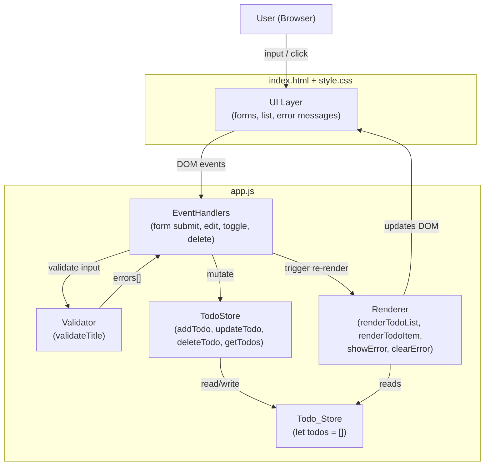

# Design Document

## Overview

The todo-list-app is a pure client-side single-page application delivered as exactly three files: `index.html`, `style.css`, and `app.js`. There is no server, no backend, no build step, and no external dependencies. All todo state lives in a single in-memory JavaScript array (`let todos = []`) declared in `app.js` and lasts only for the duration of the browser session. No data is ever written to `localStorage`, `sessionStorage`, or sent over the network. Every CRUD operation mutates the in-memory array and immediately triggers a DOM update — no page reload is ever required.

---

## Architecture



### Data flow per CRUD operation

| Operation | Flow |
|-----------|------|
| **Create** | Form submit → `EventHandlers` → `validateTitle` → `addTodo` → `renderTodoList` |
| **Read**   | Page load / any mutation → `renderTodoList` → reads `getTodos()` → updates DOM |
| **Update** | Inline edit save → `EventHandlers` → `validateTitle` → `updateTodo` → `renderTodoList` |
| **Toggle** | Toggle click → `EventHandlers` → `updateTodo` → `renderTodoList` |
| **Delete** | Delete click → `EventHandlers` → `deleteTodo` → `renderTodoList` |

Every mutation ends with a call to `renderTodoList()`, which is the single source of truth for what the DOM shows.

---

## Components and Interfaces

### TodoStore

The in-memory state and the functions that operate on it. All functions are synchronous and operate directly on the module-level `todos` array.

```js
// Internal state
let todos = []; // Todo[]

// Returns a shallow copy of all todos, ordered oldest-to-newest by createdAt.
function getTodos() { ... }

// Creates a new Todo, appends it to todos[], and returns the created Todo.
// Throws if title is invalid (callers should validate first).
function addTodo(title, description = '') { ... }

// Updates the todo with the given id. Only the fields present in `fields`
// are changed; all other fields are preserved.
// fields: { title?: string, description?: string, completed?: boolean }
// Returns the updated Todo, or null if id not found.
function updateTodo(id, fields) { ... }

// Removes the todo with the given id from todos[].
// Returns true if removed, false if id not found.
function deleteTodo(id) { ... }
```

### Validator

Stateless functions that check user input before it reaches the store.

```js
// Validates a todo title string.
// Returns an array of human-readable error message strings.
// An empty array means the title is valid.
// Rules:
//   - After trimming whitespace, length must be 1–255 characters.
function validateTitle(title) { ... }
```

### Renderer

Functions responsible for all DOM mutations. They read from `getTodos()` and write to the DOM. They never modify the `todos` array.

```js
// Clears and re-renders the entire todo list from the current store state.
// Displays the empty-state message when getTodos() returns an empty array.
function renderTodoList() { ... }

// Creates and returns a DOM element representing a single todo item.
// The element includes inline edit, toggle, and delete controls.
function renderTodoItem(todo) { ... }

// Displays an error message adjacent to inputEl.
// Creates or updates a sibling error element.
function showError(inputEl, message) { ... }

// Removes any error message associated with inputEl.
function clearError(inputEl) { ... }
```

### EventHandlers

Wired up once on `DOMContentLoaded`. Each handler reads from the DOM, delegates validation and store mutations to the appropriate components, then calls `renderTodoList()`.

```js
// Handles create-form submission.
function handleCreateSubmit(event) { ... }

// Handles saving an inline edit (triggered by a "Save" button or Enter key).
function handleEditSave(todoId) { ... }

// Handles cancelling an inline edit without saving.
function handleEditCancel(todoId) { ... }

// Handles toggling the completed status of a todo.
function handleToggle(todoId) { ... }

// Handles clicking the delete button for a todo.
function handleDelete(todoId) { ... }
```

---

## Data Models

### Todo object

```js
{
  id:          string,   // unique identifier — crypto.randomUUID() with Date.now().toString() fallback
  title:       string,   // 1–255 characters (trimmed)
  description: string,   // optional free text; empty string if not provided
  completed:   boolean,  // false on creation
  createdAt:   number    // Date.now() timestamp at creation time
}
```

ID generation strategy: use `crypto.randomUUID()` when available (all modern browsers), fall back to `Date.now().toString(36) + Math.random().toString(36).slice(2)` otherwise.

### In-memory store shape

```js
let todos = []; // Todo[] — append-only on create, mutated on update/delete
```

No serialisation, no schema migration, no external format. The array is the only representation.

---

## Correctness Properties

*A property is a characteristic or behavior that should hold true across all valid executions of a system — essentially, a formal statement about what the system should do. Properties serve as the bridge between human-readable specifications and machine-verifiable correctness guarantees.*

### Property 1: Create round-trip

*For any* valid title (1–255 non-whitespace characters) and optional description, calling `addTodo(title, description)` followed by `getTodos()` SHALL return a collection that contains exactly one todo whose `title`, `description`, and `completed` (always `false`) match the creation arguments, and whose `createdAt` is a positive integer.

**Validates: Requirements 2.2, 2.3**

### Property 2: All todo IDs are unique

*For any* sequence of N (N ≥ 2) calls to `addTodo`, the `id` values of the resulting todos SHALL all be pairwise distinct — no two todos in the store shall ever share the same `id`.

**Validates: Requirements 2.2**

### Property 3: Delete permanently removes the todo

*For any* todo that exists in the store, calling `deleteTodo(id)` SHALL result in `getTodos()` returning a collection that does not contain any todo with that `id`, regardless of how many other todos are in the store.

**Validates: Requirements 4.2**

### Property 4: Toggle flips completed and preserves all other fields

*For any* todo in the store, calling `updateTodo(id, { completed: !todo.completed })` SHALL flip the `completed` boolean and leave `id`, `title`, `description`, and `createdAt` identical to their values before the call.

**Validates: Requirements 3.6, 3.7**

### Property 5: Validation rejects every non-conforming title

*For any* string whose trimmed length is either 0 (empty or whitespace-only) or greater than 255 characters, `validateTitle(title)` SHALL return a non-empty array of error messages, thereby preventing the string from reaching `addTodo` or `updateTodo`.

**Validates: Requirements 2.4, 2.5, 3.4, 3.5**

### Property 6: UI always reflects store state

*For any* sequence of CRUD operations, calling `renderTodoList()` after each mutation SHALL produce a DOM list whose item count equals `getTodos().length` and whose items appear in strictly ascending order of `createdAt`.

**Validates: Requirements 1.1, 1.3, 2.3, 3.3, 4.2, 5.3**

---

## Error Handling

### Validation errors

Validation errors are shown inline, adjacent to the offending input field, using `showError(inputEl, message)`. The user's input is never cleared on a validation failure — they can correct it in place. As soon as the user modifies the input so that validation passes, `clearError(inputEl)` removes the message.

There is no global error state; each input field manages its own error message independently.

### Missing or not-found todos

If `updateTodo` or `deleteTodo` is called with an ID that does not exist in the store (e.g., a double-click on a delete button), the functions return `null` / `false` respectively and no DOM change occurs. No visible error is shown to the user for this case because it cannot arise from normal UI interaction.

### Browser compatibility

The app targets modern browsers (Chrome, Firefox, Safari, Edge). No polyfills are needed. If `crypto.randomUUID()` is unavailable the fallback ID generator is used transparently.

---

## Testing Strategy

### Unit tests (no framework required)

Plain JavaScript test functions using `console.assert` or a lightweight runner like [uvu](https://github.com/lukeed/uvu). No build step needed — tests run directly with `node test.js`.

**TodoStore tests** — specific examples and boundary conditions:

| Test | What to verify |
|------|---------------|
| `addTodo` with valid title | Store length increases by 1; returned todo has correct fields; `completed` is `false` |
| `addTodo` × N | All N resulting IDs are distinct |
| `getTodos` returns copy | Mutating the returned array does not affect the internal store |
| `getTodos` ordering | Returns todos in ascending `createdAt` order |
| `updateTodo` partial update | Only supplied fields change; others preserved |
| `updateTodo` unknown id | Returns `null`; store unchanged |
| `deleteTodo` owned id | Store no longer contains that id; returns `true` |
| `deleteTodo` unknown id | Returns `false`; store unchanged |

**Validator tests** — boundary and category coverage:

| Test | Input | Expected |
|------|-------|----------|
| Empty string | `""` | errors array non-empty |
| Whitespace only | `"   "` | errors array non-empty |
| Single character | `"a"` | errors array empty |
| Exactly 255 chars | `"a".repeat(255)` | errors array empty |
| 256 chars | `"a".repeat(256)` | errors array non-empty |
| Untrimmed valid | `"  hello  "` | errors array empty (trimmed to 5 chars) |

### Property-based tests

Use [fast-check](https://github.com/dubzzz/fast-check) (run with Node, no browser needed).

Minimum 100 iterations per property. Each test is tagged with a comment:
`// Feature: todo-list-app, Property N: <property text>`

| Property | Generator inputs |
|----------|-----------------|
| 1 — Create round-trip | `fc.string({ minLength: 1, maxLength: 255 })` for title; `fc.string()` for description |
| 2 — Unique IDs | `fc.integer({ min: 2, max: 50 })` for N; run N `addTodo` calls; assert all IDs distinct |
| 3 — Delete removes todo | Arbitrary store of 1–20 todos; random pick one id; delete; assert absent |
| 4 — Toggle preserves fields | Arbitrary store; random pick one todo; toggle; assert only `completed` changed |
| 5 — Validation rejects bad titles | `fc.oneof(fc.constant(""), fc.string().map(s => " ".repeat(s.length)), fc.string({ minLength: 256 }))` |
| 6 — UI reflects store state | Arbitrary sequence of add/update/delete operations; assert DOM item count and order after each |

### Manual browser testing checklist

The following scenarios require a human to verify visual correctness, focus behaviour, and cross-browser compatibility:

- [ ] App loads in Chrome, Firefox, Safari, and Edge without errors in the console
- [ ] Empty state message is visible on first load
- [ ] Creating a todo appends it to the list; form inputs clear after submit
- [ ] Creating with an empty title shows an inline error; error disappears when title is typed
- [ ] Creating with a 256-character title shows an inline error
- [ ] Completed todo renders visually distinct (e.g., strikethrough) from incomplete todos
- [ ] Clicking the toggle control changes the visual state without a page reload
- [ ] Clicking the edit control makes the title and description editable inline
- [ ] Saving an edit with a valid title updates the displayed values
- [ ] Saving an inline edit with an empty title shows an inline error
- [ ] Cancelling an inline edit restores the original values
- [ ] Clicking delete removes the item from the list; deleting the last item shows the empty state
- [ ] All operations work without any network requests (verify in DevTools → Network tab)
